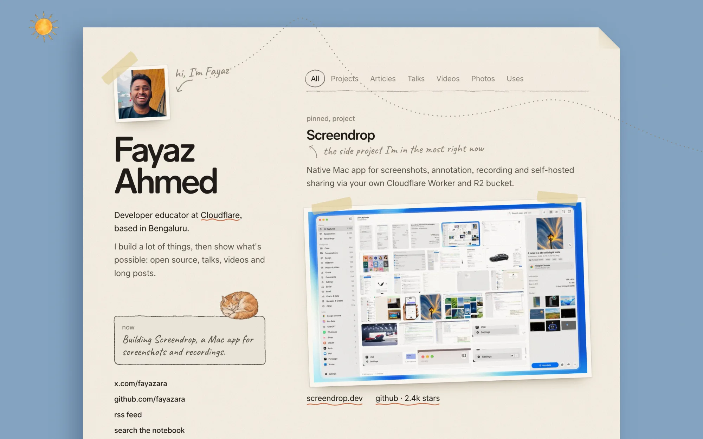
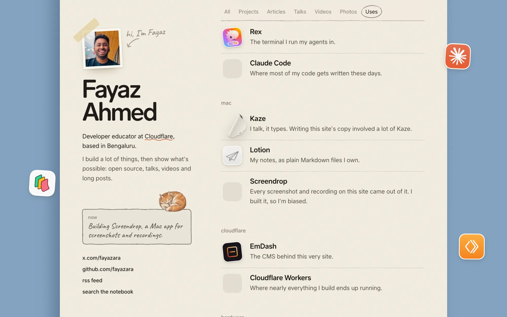
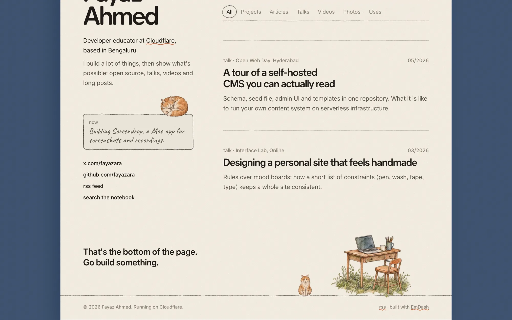
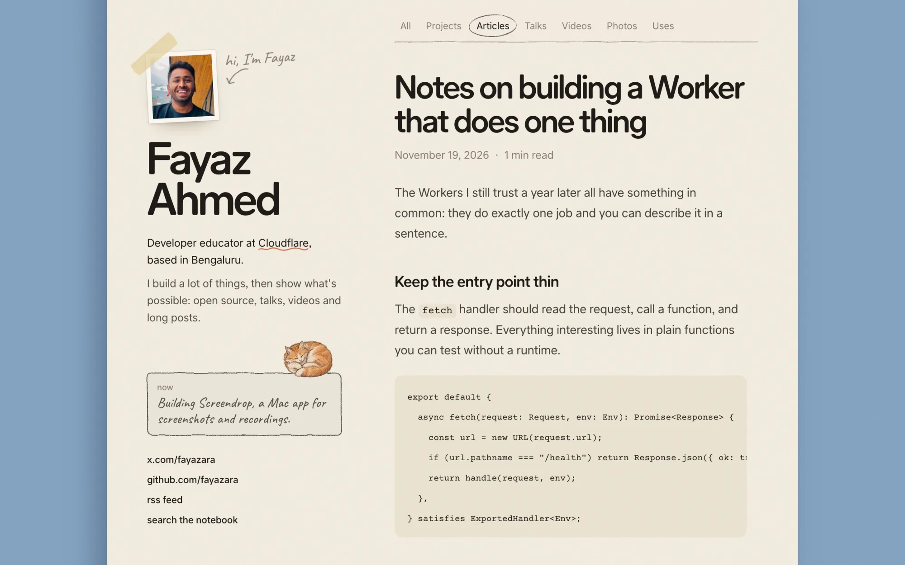
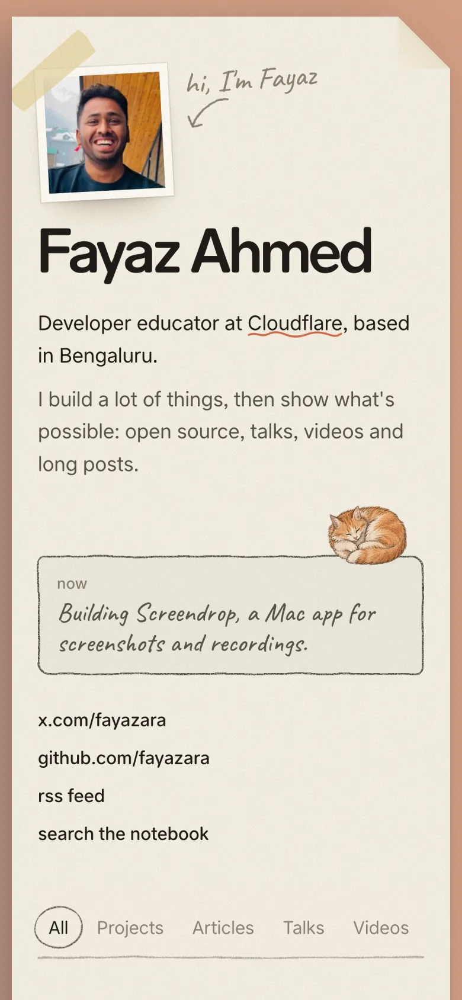

# Sketchbook

A personal site that looks like one page of a field notebook, lying on a dusty-blue desk. Built with [EmDash](https://github.com/emdash-cms/emdash) and Astro, and deployed on Cloudflare Workers with D1 and R2.

[](https://deploy.workers.cloudflare.com/?url=https://github.com/fayazara/sketchbook)



## The idea

Everything on the page has to look like it belongs on one sheet of paper:

- **One sheet.** Paper grain prints through everything on it, and the top-right corner is turned down.
- **Hand-made things are pen and wash.** Borders and rules go through a pencil filter, links are underlined with a scribble, the active tab is circled in pen, and the illustrations are pen-and-watercolour sketches.
- **Everything else is taped in.** Screenshots, photos and the avatar are prints, held down with tape you can peel off.
- **Type.** [Allo](https://allo.joshpuckett.me) for text and titles, Courier Prime for code, and Caveat for the odd handwritten margin note.

## Small living things

All optional decoration. Visitors who prefer reduced motion get the still versions.

- A paper plane is thrown from the "hi" note when the page opens, flown by a small glider simulation, so no two flights are the same.
- A cat sleeps on the "now" note, wakes up and watches the cursor, and purrs when you hover it. Another one walks the footer as you scroll down.
- The desk follows the visitor's time of day (dawn, day, dusk, night). Click the sun or moon to change it.
- Pen strokes draw themselves as they scroll into view, a bird flies between feed entries, and the avatar polaroid flips over.
- On `/uses`, every app and gadget is a die-cut sticker. Drag one and it peels off the page, then stick it anywhere, even on the desk. Drop it on the cat and you'll hear about it.

| Uses, with stickers peeled off | The footer at night |
|---|---|
|  |  |

| An article | On a phone |
|---|---|
|  |  |

## What's included

| Page | Route |
|---|---|
| Everything, newest first (only featured projects) | `/` |
| Projects, as a contents page | `/projects` |
| Articles, and a single article | `/posts`, `/posts/:slug` |
| Talks | `/talks` |
| Videos (YouTube, loaded on click) | `/videos` |
| Photos | `/photos` |
| Uses, with peelable stickers | `/uses` |
| Search | `/search` |
| RSS | `/rss.xml` |

Content lives in EmDash collections: `posts`, `projects`, `talks`, `videos`, `photos`, `uses` and `pages`. Every feed collection has an optional `note` field, shown as a handwritten aside next to the entry. Anything can be pinned to the top of the feed.

## Getting started

```bash
pnpm install
pnpm dev
```

Open http://localhost:4321/_emdash/admin and complete the setup wizard. EmDash runs the migrations and applies the demo content from `seed/seed.json`. The site is at http://localhost:4321.

## Making it yours

- **Profile, links and tabs:** `src/site.ts` and `src/components/Profile.astro`. Your photo goes in `public/avatar.jpg`.
- **Content:** edit everything in the admin, or change `seed/seed.json` before your first run. The demo articles and talks are placeholders.
- **Colours:** `src/styles/theme.css`, including the four times of day.
- **Sketches:** `public/art/`, all drawn in the same pen-and-watercolour style. To add one, generate it on a transparent background and register its size in `src/components/Spot.astro`.
- **Stickers:** start from a transparent PNG. For a photo, remove the background first (on macOS, `swift scripts/cutout.swift photo.jpg cutout.png`). Then run:

  ```bash
  node scripts/sticker.mjs cutout.png public/stickers/my-thing.webp --clean
  ```

  and set the Uses entry's `sticker` field to `/stickers/my-thing.webp`.

`AGENTS.md` describes the design rules and how each part works in more detail, for you or your coding agent.

## Deploying

```bash
pnpm wrangler login
pnpm deploy
```

The first deploy provisions the D1 database and R2 bucket named in `wrangler.jsonc`. See [Deploy to Cloudflare](https://docs.emdashcms.com/deployment/cloudflare/) for production setup, or use the button above.

## Credits

- [Allo](https://allo.joshpuckett.me) by Josh Puckett, [Caveat](https://fonts.google.com/specimen/Caveat) and [Courier Prime](https://fonts.google.com/specimen/Courier+Prime), all under the SIL Open Font License.
- Built on the [EmDash](https://emdashcms.com) blog template for Cloudflare.
- The product photos and app icons in `public/stickers/` and the screenshots in `public/projects/` belong to their owners and are here as examples. Replace them with your own.

## License

[MIT](LICENSE)
